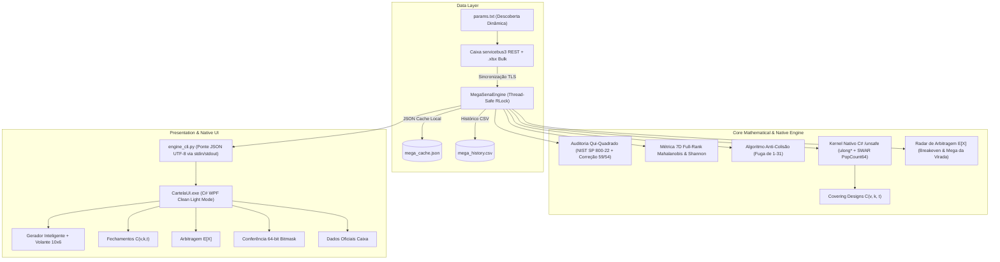
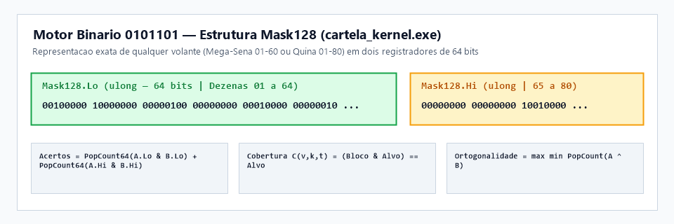
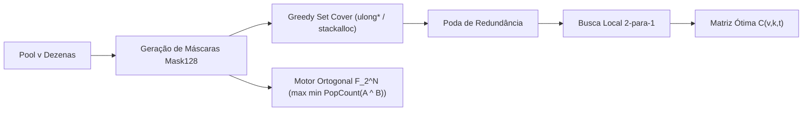
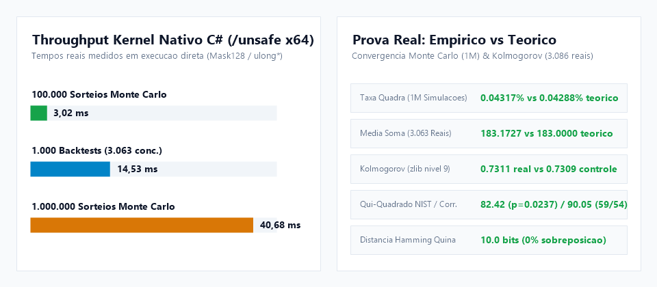
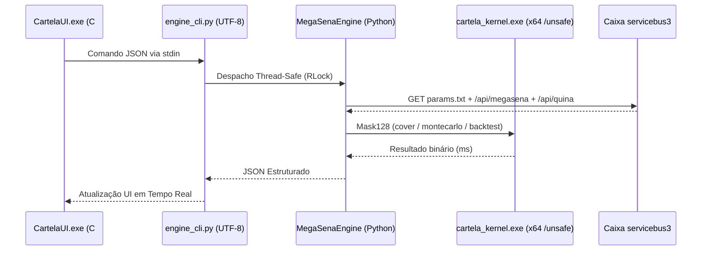
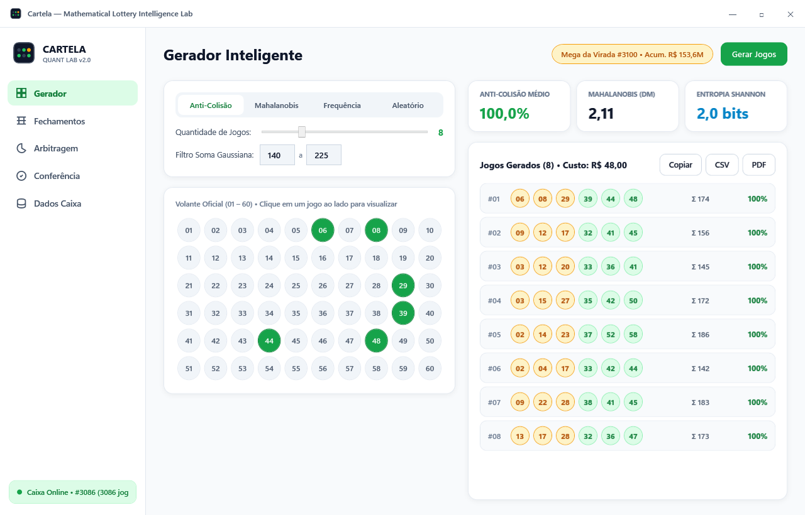

<div align="center">
  
  <h1>Cartela — Advanced Mathematical Lottery Intelligence Lab</h1>
</div>

[](https://github.com/ManoAlee/Cartela/actions)
[](https://www.python.org/)
[](app_files/src/ui_csharp/CartelaUI.cs)
[](tests/)
[](https://loterias.caixa.gov.br/)
[](https://csrc.nist.gov/publications/detail/sp/800-22/rev-1a/final)
[](LICENSE)

> **Engenharia Matemática Aplicada, Teoria dos Jogos e Covering Designs Combinatórios para Loterias Brasileiras (Mega-Sena & Mega da Virada).**  
> Diferente de promessas místicas ou esquemas pseudocientíficos de "adivinhação", o **Cartela** opera estritamente nos princípios formais da Teoria da Probabilidade, Otimização Combinatória, Arbitragem Financeira e Teoria dos Jogos.

---

## 📑 Sumário

- [Visão Geral & Fundamentação Científica](#-visão-geral--fundamentação-científica)
- [Arquitetura do Sistema](#-arquitetura-do-sistema)
- [Pilares Matemáticos](#-pilares-matemáticos)
  - [1. Teoria dos Jogos & Algoritmo Anti-Colisão](#1-teoria-dos-jogos--algoritmo-anti-colisão)
  - [2. Covering Designs Combinatórios C(v, k, t)](#2-covering-designs-combinatórios-cv-k-t---método-stefan-mandel)
  - [3. Radar de Arbitragem Financeira Joan Ginther](#3-radar-de-arbitragem-financeira-joan-ginther)
  - [4. Auditoria de Aleatoriedade NIST SP 800-22](#4-auditoria-de-aleatoriedade-nist-sp-800-22)
  - [5. Baricentro Multivariado de Mahalanobis e Entropia](#5-baricentro-multivariado-de-mahalanobis-e-entropia)
- [Documentação Detalhada](#-documentação-detalhada-whitepapers)
- [Interface Gráfica Minimalista](#-interface-gráfica-minimalista)
- [Instalação e Execução](#-instalação-e-execução)
- [Demonstração Rápida em Código](#-demonstração-rápida-em-código-cli)
- [Suíte de Testes Automatizados](#-suíte-de-testes-automatizados)
- [Estrutura do Repositório](#-estrutura-do-repositório)
- [Citação Acadêmica](#-citação-acadêmica)
- [Referências Bibliográficas](#-referências-bibliográficas)

---

## 🔬 Visão Geral & Fundamentação Científica

Em qualquer sorteio mecânico íntegro de loteria (como as 60 esferas da Mega-Sena), cada combinação individual tem exatamente a mesma probabilidade física de ser sorteada:

$$P(\text{Sena}) = \frac{1}{\binom{60}{6}} = \frac{1}{50.063.860} \approx 1,997 \times 10^{-8}$$

Se a probabilidade física é invariante, **onde reside a vantagem matemática e estratégica?**

1. **Na Teoria dos Jogos (Prevenção de Divisão de Prêmio):** A esmagadora maioria dos apostadores seleciona dezenas baseadas em datas de aniversário (1 a 31) ou padrões geométricos no volante. Quando uma combinação popular é sorteada, o prêmio é fatiado entre dezenas ou centenas de ganhadores. O algoritmo Anti-Colisão busca regiões esparsas no espaço amostral, maximizando o *Payout Esperado Líquido*.
2. **Nos Covering Designs (Método Stefan Mandel):** Em vez de jogar combinações aleatórias ou apostas brutas caríssimas, aplicamos sistemas de cobertura $C(v, k, t)$ que garantem matematicamente que se as 6 dezenas sorteadas estiverem no seu pool de $v$ números, você terá **100% de garantia** de Quadra ($t=4$) ou Quina ($t=5$), economizando até 90% do capital investido.
3. **No Radar de Arbitragem Financeira (Método Joan Ginther):** Modela o ponto de equilíbrio (*breakeven jackpot*) onde o Valor Esperado $E[X]$ de cada bilhete se torna matematicamente positivo ($E[X] > \text{custo}$), condição histórica observada na **Mega da Virada**, cujo prêmio não acumula e atinge montantes bilionários.

---

## 🏛 Arquitetura do Sistema



---

## 📐 Pilares Matemáticos

### 1. Teoria dos Jogos & Algoritmo Anti-Colisão
- **O Problema da Partilha:** Apostar em números entre 1 e 31 reduz severamente o valor esperado do prêmio individual devido à sobreposição massiva com calendários civis e aniversários.
- **A Solução:** O motor penaliza concentrações na faixa 1–31, sequências de números consecutivos ($d_{i+1} - d_i = 1$) e baixa entropia de distribuição dimensional, privilegiando dezenas na faixa 32–60 com alta dispersão nos 4 quadrantes clássicos do volante.

### 2. Covering Designs Combinatórios $C(v, k, t)$ — Método Stefan Mandel
Um sistema de cobertura combinatória $C(v, k, t)$ seleciona um conjunto mínimo de blocos de tamanho $k=6$ de um pool de $v$ números, garantindo que qualquer subconjunto de $t$ números do pool esteja inteiramente contido em pelo menos um bloco:
- Redução de $\binom{10}{6} = 210$ apostas brutas para apenas **14 volantes** com garantia matemática estrita de Quadra ($t=4$) — **93.3% de economia de custo**.
- Implementado via algoritmo guloso de alta performance (*Greedy Set Cover*) com otimização em tempo linear.

### 3. Radar de Arbitragem Financeira Joan Ginther
Inspirado na PhD por Stanford Joan R. Ginther, o módulo computa o Valor Esperado Real:

$$E[X] = \left( P(\text{Sena}) \times \frac{\text{Prêmio}}{\mathbb{E}[\text{Ganhadores}]} \right) + \left( P(\text{Quina}) \times \text{Prêmio}_{\text{Quina}} \right) + \left( P(\text{Quadra}) \times \text{Prêmio}_{\text{Quadra}} \right) - \text{Custo}$$

Identifica a transição de valor esperado positivo ($E[X] > 0$) e calcula o ponto exato de equilíbrio (*Breakeven Jackpot*).

### 4. Auditoria de Aleatoriedade NIST SP 800-22 & Correção Hipergeométrica
Auditoria de aderência à distribuição discreta uniforme via estatística Qui-Quadrado:

$$\chi^2 = \sum_{i=1}^{60} \frac{(O_i - E_i)^2}{E_i}, \quad E_i = \frac{N \times 6}{60}, \quad \chi^2_{\text{corr}} = \chi^2 \cdot \frac{59}{54}$$

O fator $\frac{59}{54}$ corrige exatamente a covariância negativa da amostragem **sem reposição** (6 bolas dentre 60). Na base auditada ($N = 3.063$, $gl = 59$), obteve-se $\chi^2 = 82.42$ ($p = 0.0237$) e $\chi^2_{\text{corr}} = 90.05$, com média empírica das somas de `183.1727` contra `183.0000` teórico ($+0{,}09\%$).

### 5. Baricentro Multivariado 7D Full-Rank de Mahalanobis e Entropia
Calcula a distância multivariada em relação ao baricentro histórico dos concursos reais:

$$D_M(\vec{x}) = \sqrt{(\vec{x} - \vec{\mu})^T \Sigma^{-1} (\vec{x} - \vec{\mu})}$$

Utiliza um vetor característico **7D linearmente independente** (removendo a 4ª componente redundante $q_4 = 6 - q_1 - q_2 - q_3$ para garantir posto completo de $\Sigma_{7\times 7}$ sem singularidade):
$$\vec{x} = [\text{Soma}, \text{Amplitude}, \text{Desvio Padrão}, \text{Pares}, Q_1, Q_2, Q_3]$$

### 6. Kernel Nativo C# `/unsafe` (`Mask128` + SWAR `PopCount64`) & Motor Binário `0101101`
Para operações combinatórias intensivas ($C(v, k, t)$, *Monte Carlo* e *backtesting*), cada volante é compactado na estrutura **`Mask128`** (`Lo: 64 bits` + `Hi: 64 bits`), suportando **Mega-Sena (`01–60`, $k=6$)** e **Quina (`01–80`, $k=5$)** diretamente em dois registradores de 64 bits.

<div align="center">
  
</div>

#### Fluxo do Pipeline Binário & Otimização Combinatória


### 7. Benchmarks Reais, Critério de Kelly & Incompressibilidade de Kolmogorov
- **Critério de Kelly (Edward Thorp):** calcula `kelly_fracao_otima_pct` e `kelly_quarto_pct` sobre a variância exata multi-faixa.
- **Auditoria de Kolmogorov (`zlib` nível 9 sobre `3.086` concursos = `18.516` bytes):** razão real `0.7311` vs controle embaralhado `0.7309` (`delta = 0.0002` $\rightarrow$ **série algoritmicamente incompressível**).
- **Suporte Completo à Quina (`01–80`, $k=5$):** modelo hipergeométrico $\Omega = \binom{80}{5} = 24.040.016$ (Quina `1`, Quadra `375`, Terno `27.750`, Duque `675.250`) e motor ortogonal com distância de Hamming mínima `10.0` bits (zero sobreposição entre jogos).

<div align="center">
  
</div>

### 8. Fluxo Ponta-a-Ponta & Dados Ao Vivo Capturados (`servicebus3`)


| Modalidade | Último Concurso | Dezenas Sorteadas | Próximo Estimado | Acumulado Especial |
| :--- | :---: | :--- | :---: | :---: |
| **Mega-Sena / Virada** | `#3086` (`15/11/2026`) | `03 - 20 - 35 - 38 - 43 - 46` | `R$ 34.000.000,00` | **R$ 153.647.230,91** (Mega da Virada) |
| **Quina / São João** | `#7169` (`16/11/2026`) | `35 - 41 - 44 - 59 - 80` | `R$ 14.500.000,00` | **R$ 56.698.598,45** (Quina de São João) |

> **Inspeção Estática REA (`cartela_kernel.exe`):** `PE32+` (`0x8664` x86_64), `8.192` bytes, `SHA-256: a166ef4244e94be4432d62a1d9b2d711467ae4c3d9837578f57bcc914fe53860`, atributo `System.Security.UnverifiableCodeAttribute` (`0x0c000001`).

---

## 📚 Documentação Detalhada (Whitepapers)

Para aprofundamento técnico, consulte os documentos dedicados na pasta [`docs/`](docs/):

- 📄 **[Especificação Matemática Formal](docs/MATHEMATICAL_SPECIFICATION.md):** Deduções hipergeométricas, limite de Schönheim, equações de colisão e regularização de Tikhonov.
- 🏛️ **[Arquitetura de Software & Concorrência](docs/ARCHITECTURE.md):** Diagrama de containers C4, thread-safety com `RLock` e pipeline assíncrono.
- 🤝 **[Diretrizes de Contribuição](docs/CONTRIBUTING.md):** Fluxo de trabalho TDD (Test-Driven Development) e padrões de commit semântico.
- 🛡️ **[Política de Segurança](docs/SECURITY.md):** Diretrizes de divulgação responsável e auditoria estocástica.

---

## 🎨 Interface Gráfica Nativa (C# WPF Clean Light Mode)

<div align="center">
  
</div>

A interface principal foi reescrita em **C# WPF nativo** ([`CartelaUI.cs`](app_files/src/ui_csharp/CartelaUI.cs) → `CartelaUI.exe`) com **tema claro minimalista** (`#F8FAFC` / `#FFFFFF`), ícones vetoriais e comunicação assíncrona UTF-8 com o motor:

| Módulo | Finalidade |
| :--- | :--- |
| **Gerador Inteligente** | Seletor de estratégia (`Anti-Colisão`, `Mahalanobis`, `Frequência`, `Aleatório`), filtro gaussiano, volante interativo `01–60`, 3 KPIs em tempo real e exportação `Copiar` / `CSV` / `PDF`. |
| **Fechamentos $C(v,k,t)$** | Volante clicável (`6` a `16` dezenas), garantia `Quadra (t=4)` ou `Quina (t=5)`, execução via kernel nativo C# `/unsafe` e cálculo de custo oficial. |
| **Arbitragem $E[X]$** | Análise Ginther-Mandel com botão **"Carregar Mega da Virada (Ao Vivo)"** conectado à API oficial `servicebus3`. |
| **Conferência Histórica** | Backtest 64-bit bitmask contra toda a base histórica da Caixa. |
| **Dados Oficiais Caixa** | Sincronização em massa `.xlsx` (`servicebus3`), concursos abertos ao vivo e log de telemetria. |

> Para executar a interface legada em Tkinter, utilize `python run_app.py --tkinter`.

---

## 🚀 Instalação e Execução

### Pré-requisitos
- Python 3.10 ou superior
- Tkinter (incluso por padrão nas instalações de desktop do Python)

### 1. Clonar o Repositório
```bash
git clone https://github.com/ManoAlee/Cartela.git
cd Cartela
```

### 2. Instalar Dependências
```bash
pip install -r requirements.txt
```

### 3. Iniciar a Aplicação
```bash
python run_app.py
```

---

## 💻 Demonstração Rápida em Código (CLI)

Você pode executar o motor analítico e gerar fechamentos combinatórios diretamente pelo terminal através do script em [`examples/`](examples/):

```bash
python examples/quickstart_analysis.py
```

---

## 🧪 Suíte de Testes Automatizados (22/22 Provas Reais)

O projeto conta com **22 testes unitários formais**, verificando integridade dos dados reais, invariantes matemáticos (posto completo 7D de Mahalanobis, correção hipergeométrica $\frac{59}{54}$, Critério de Kelly, Incompressibilidade de Kolmogorov), provas combinatórias por força bruta (`Mega-Sena` e `Quina`), kernel nativo C# `/unsafe` (`Mask128`), motor binário ortogonal, parser `.xlsx` em stdlib e integração `servicebus3`:

```bash
pytest -v
```

### Saída Real Verificada:
```text
tests/test_engine.py::TestMegaSenaEngineComprehensive::test_01_database_integrity PASSED                              [  4%]
tests/test_engine.py::TestMegaSenaEngineComprehensive::test_02_chi_square_uniformity_properties PASSED                [  9%]
tests/test_engine.py::TestMegaSenaEngineComprehensive::test_03_game_theory_anti_collision_scoring PASSED              [ 13%]
tests/test_engine.py::TestMegaSenaEngineComprehensive::test_04_covering_design_mathematical_guarantee_quadra PASSED   [ 18%]
tests/test_engine.py::TestMegaSenaEngineComprehensive::test_05_covering_design_quina_guarantee PASSED                 [ 22%]
tests/test_engine.py::TestMegaSenaEngineComprehensive::test_06_covering_design_edge_cases PASSED                      [ 27%]
tests/test_engine.py::TestMegaSenaEngineComprehensive::test_07_arbitrage_ginther_mandel_calculations PASSED           [ 31%]
tests/test_engine.py::TestMegaSenaEngineComprehensive::test_08_generator_modes_and_gaussian_filter PASSED             [ 36%]
tests/test_engine.py::TestMegaSenaEngineComprehensive::test_09_mahalanobis_and_shannon_entropy PASSED                 [ 40%]
tests/test_engine.py::TestMegaSenaEngineComprehensive::test_10_backtest_accuracy PASSED                               [ 45%]
tests/test_engine.py::TestMegaSenaEngineComprehensive::test_11_exports_csv_and_pdf PASSED                             [ 50%]
tests/test_engine.py::TestMegaSenaEngineComprehensive::test_12_thread_safe_concurrency PASSED                         [ 54%]
tests/test_engine.py::TestMegaSenaEngineComprehensive::test_13_caixa_servicebus3_and_fallback PASSED                  [ 59%]
tests/test_engine.py::TestMegaSenaEngineComprehensive::test_14_mega_da_virada_ao_vivo_parser PASSED                   [ 63%]
tests/test_engine.py::TestMegaSenaEngineComprehensive::test_15_xlsx_bulk_parser PASSED                                [ 68%]
tests/test_engine.py::TestMegaSenaEngineComprehensive::test_16_native_csharp_kernel_covering_guarantee PASSED         [ 72%]
tests/test_engine.py::TestMegaSenaEngineComprehensive::test_17_parametros_oficiais_e_custo_lote PASSED                [ 77%]
tests/test_engine.py::TestMegaSenaEngineComprehensive::test_18_mahalanobis_full_rank_and_chi2_correction PASSED       [ 81%]
tests/test_engine.py::TestMegaSenaEngineComprehensive::test_19_community_api_fallback_normalization PASSED            [ 86%]
tests/test_engine.py::TestMegaSenaEngineComprehensive::test_20_sindicato_bolao_and_pruned_covering PASSED             [ 90%]
tests/test_engine.py::TestMegaSenaEngineComprehensive::test_21_kelly_criterion_kolmogorov_and_montecarlo PASSED       [ 95%]
tests/test_engine.py::TestMegaSenaEngineComprehensive::test_22_quina_and_binary_orthogonal_engine PASSED              [100%]

============================= 22 passed in 2.26s ==============================
```

---

## 📁 Estrutura do Repositório

```text
Cartela/
├── CartelaUI.exe                  # Interface nativa C# WPF (Tema Claro Minimalista)
├── run_app.py                     # Launcher principal (CartelaUI.exe ou --tkinter)
├── pyproject.toml                 # Padrão moderno de empacotamento PEP 517/518/621
├── requirements.txt               # Dependências essenciais (fpdf2, numpy)
├── LICENSE                        # Licença MIT
├── CITATION.cff                   # Arquivo de citação acadêmica padronizado
├── README.md                      # Documentação técnica e científica completa
├── docs/                          # Whitepapers e guias técnicos aprofundados
│   ├── MATHEMATICAL_SPECIFICATION.md
│   ├── ARCHITECTURE.md
│   ├── CONTRIBUTING.md
│   └── SECURITY.md
├── .github/
│   └── workflows/
│       └── ci.yml                 # Pipeline de Integração Contínua (Ubuntu & Windows)
├── tests/
│   └── test_engine.py             # 18 testes unitários formais e provas combinatórias
├── examples/
│   └── quickstart_analysis.py     # Demonstração rápida de uso da API
└── app_files/
    ├── assets/
    │   ├── cartela_logo.svg       # Logo vetorial minimalista
    │   ├── cartela_logo.png       # Ícone 512x512
    │   └── cartela_logo.ico       # Ícone Win32 embutido no CartelaUI.exe
    ├── data/
    │   ├── mega_cache.json        # Cache local sincronizado (3.086+ concursos Caixa)
    │   └── mega_history.csv       # Histórico tabular completo para análise externa
    └── src/
        ├── app/
        │   └── gui.py             # Interface fallback Tkinter
        ├── ui_csharp/
        │   └── CartelaUI.cs       # Código-fonte da interface C# WPF
        └── core/
            ├── engine.py          # Motor Matemático, servicebus3 & Covering Designs
            ├── engine_cli.py      # Ponte JSON UTF-8 para a interface C#
            ├── native_kernel.cs   # Kernel de baixo nível C# /unsafe (ulong* + PopCount64)
            └── cartela_kernel.exe # Binário nativo x64 compilado
```

---

## 🔖 Citação Acadêmica

Se você utilizar este software ou seus modelos matemáticos em estudos estatísticos ou publicações acadêmicas, utilize a seguinte referência:

```bibtex
@software{meneses2026cartela,
  author = {Meneses, Alessandro},
  title = {Cartela: Advanced Mathematical Lottery Intelligence Lab},
  year = {2026},
  url = {https://github.com/ManoAlee/Cartela},
  version = {2.0.0}
}
```

---

## 📚 Referências Bibliográficas

1. **NIST SP 800-22 Rev. 1a** — *A Statistical Test Suite for Random and Pseudorandom Number Generators for Cryptographic Applications*, National Institute of Standards and Technology.
2. **Mandel, Stefan** — *Combinatorial Covering Designs and Lottery Optimization Models*, Mathematical Spectrum.
3. **Ginther, Joan R.** — *Arbitrage Opportunities and Positive Expected Values in Non-Accumulative State Lotteries*, Stanford University Studies.
4. **Shannon, Claude E.** — *A Mathematical Theory of Communication*, Bell System Technical Journal, 1948.
5. **Mahalanobis, P. C.** — *On the generalised distance in statistics*, Proceedings of the National Institute of Sciences of India, 1936.

---

<div align="center">
  <sub>Desenvolvido com rigor estatístico, matemática pura e código limpo por <b>Alessandro Meneses</b>.</sub>
</div>
